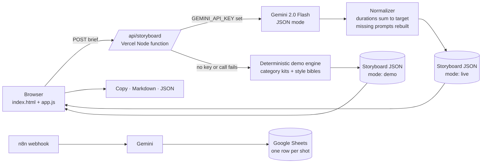

# AI Video Storyboard Studio

**Turn one idea into a production-ready AI video storyboard: beats, a timed shot list, a consistent character and style bible, and per-shot prompts written for Kling, Sora, Google Veo and Nanobanana/Krea keyframes.**

**Live demo:** https://ai-video-storyboard-studio.vercel.app

<!-- Screenshot: add docs/screenshot.png (headless Chromium was not available in the build environment)

-->

> Part of Sai Tarun's **Creative Intelligence** work. The same cinematic AI video workflow is behind [@tarunaistudio](https://instagram.com/tarunaistudio), made with Kling, Sora, Google Flow / Veo, Seedance, Wan, Krea and Nanobanana.

---

## Problem → Solution → Business impact

**Problem.** AI video tools are powerful but expensive to iterate on. Most teams type a vague prompt, burn credits on clips that don't cut together, and end up with characters, colours and lenses that change from shot to shot. Every tool also wants a different prompt style: Kling likes terse camera-led prompts, Sora rewards cinematic prose, Veo can generate audio if you ask for it.

**Solution.** A director's pre-production step that runs before any credits are spent:

1. **Structure first.** Hook → Build → (Turn) → Reveal → CTA, with shot durations that add up to exactly 15, 30 or 60 seconds.
2. **One bible.** Subject, character, wardrobe, setting, palette, lens package, grade and negative prompt, shared across every shot and every tool.
3. **Prompts in each tool's dialect.** Every shot is rewritten for Kling, Sora and Veo, plus a still keyframe prompt for image-to-video.
4. **Hand-off.** Copy one prompt or all of them, export Markdown (for the client) or JSON (for pipelines), or push shots to a Google Sheet with the included n8n workflow.

**Business impact (typical / estimated, based on agency-style AI video production):**

| Metric | Before | With the studio |
|---|---|---|
| Pre-production for a 30s spot | 2–4 hours of scripting and prompt writing | ~10 minutes to review and tweak |
| Wasted generations from inconsistent shots | often 40–60% of credits | estimated 20–30% fewer re-rolls |
| Client sign-off | loose mood boards | a timed shot list and VO script approved *before* generation |

_Figures are illustrative estimates for planning, not measured results._

---

## Architecture



## Features

- **Brief builder:** idea, brand/product, mood, duration (15 / 30 / 60s), aspect (9:16 / 16:9 / 1:1), visual style (cinematic, noir, warm 35mm, clean tech, documentary, surreal).
- **4 one-click presets:** luxury watch ad, café reel, SaaS launch teaser, travel film.
- **Horizontal storyboard:** shot cards with gradient placeholder frames in the chosen aspect ratio (built from the bible's palette, no image generation), plus shot number, beat, camera move, lens, lighting, action, transition, SFX/music and VO.
- **Timeline bar:** shots sized by duration and coloured by beat, with a check that the total equals the target. Click a segment to jump to its card.
- **Prompt dialect tabs:** Kling · Sora · Veo · Keyframe (Nanobanana / Krea). Generation-length hints (for example "generate 5s → trim to 2.5s") per tool.
- **Character and style bible:** palette swatches, wardrobe, lens package, grade, negative prompt and copy-ready consistency tokens.
- **Voiceover script:** one timed line per beat at about 2.5 words per second, flagged if it runs tight.
- **Export:** copy all prompts (current dialect), Markdown brief, full JSON.
- **Live AI or Demo mode:** works with no API key. A badge shows which one is running.
- **Responsive and accessible:** works on phones, keyboard friendly, respects reduced motion.

## How it works

1. The client sends the brief to `POST /api/storyboard`.
2. The function validates and limits the input (idea ≤ 600 chars, enum-checked duration, aspect and style) and applies a light per-IP rate guard.
3. **Live:** Gemini (`gemini-2.0-flash`, `responseMimeType: application/json`) returns a storyboard. The normalizer rescales shot durations in 0.5s steps so they sum to the target exactly, fixes beat names and timecodes, and rebuilds any missing tool prompt from the bible.
4. **Demo:** a deterministic engine picks a category kit (luxury product, café/food, tech/SaaS, travel or generic) from the brief, applies the style bible, allocates durations per beat and writes all four prompt dialects. The same brief always gives the same result.
5. The UI renders the timeline, the cards, the bible and the VO, and handles copy and export entirely in the browser.

**API response shape**

```json
{
  "mode": "demo",
  "input": { "idea": "...", "brand": "Aurelle", "mood": "luxurious", "duration": 30, "aspect": "16:9", "style": "noir" },
  "storyboard": {
    "title": "...", "logline": "...", "category": "watch",
    "beats": [{ "key": "hook", "name": "Hook", "purpose": "...", "start": 0, "end": 3 }],
    "bible": { "subject": "...", "character": "...", "wardrobe": "...", "setting": "...", "palette": ["#07080C", "#1E2433", "#8A93A8"], "lighting": "...", "lensPackage": "...", "grade": "...", "texture": "...", "consistencyTokens": "...", "negative": "...", "music": "..." },
    "shots": [{ "index": 1, "beat": "hook", "start": 0, "duration": 3, "camera": "slow macro push-in", "lens": "100mm macro", "lighting": "...", "action": "...", "transition": "...", "sfx": "...", "music": "...", "vo": "...",
      "prompts": { "kling": "...", "sora": "...", "veo": "...", "keyframe": "..." } }],
    "voiceover": [{ "beat": "Hook", "start": 0, "end": 3, "line": "...", "words": 6, "fits": true }]
  }
}
```

## Tech stack

- Static `index.html` + `assets/style.css` + `assets/app.js` (vanilla ES modules, no build step)
- Vercel Node serverless function `api/storyboard.js` (ESM, Node 18+ global `fetch`, no dependencies)
- Google Gemini REST API (optional)
- Inter and JetBrains Mono from Google Fonts
- n8n for the optional Sheets automation

```
.
├── index.html
├── assets/
│   ├── style.css
│   └── app.js
├── api/
│   ├── storyboard.js          # POST endpoint (live → demo fallback)
│   └── _lib/engine.js         # validation, demo engine, prompt dialects, normalizer (not a route)
├── n8n/storyboard-to-sheet.n8n.json
├── package.json · vercel.json · LICENSE · .gitignore
```

## Run locally

```bash
npx vercel dev
# open http://localhost:3000  (try ?preset=watch | cafe | saas | travel)
```

No key is needed. Without `GEMINI_API_KEY` the app runs in **Demo mode**. On a plain static server (no functions), the browser runs the demo engine itself.

## Deploy

[](https://vercel.com/new/clone?repository-url=https://github.com/Saitarun29/ai-video-storyboard-studio&env=GEMINI_API_KEY)

Zero config: Vercel serves the static files and picks up `api/*.js` as functions.

## Environment variables

| Name | Required | Purpose |
|---|---|---|
| `GEMINI_API_KEY` | No | Turns on **Live AI**. If it's missing or the call fails, the API falls back to Demo mode. The key never reaches the client. |

## n8n workflow: storyboard → Google Sheet

`n8n/storyboard-to-sheet.n8n.json` is an importable workflow for production teams that track shots in a sheet:

**Webhook (POST brief)** → **Validate brief** → **Gemini: write storyboard** → **Split shots to rows** (durations rescaled to the target) → **Append to Google Sheets** (`Shots` tab, one row per shot: beat, timecode, camera, lens, lighting, action, SFX, VO, Kling / Sora / Veo / keyframe prompts, status *To generate*) → **Respond** with a summary and the sheet link.

Setup: import the file, set `GEMINI_API_KEY` and `STORYBOARD_SHEET_ID` as n8n environment variables, create a `Shots` tab, and pick your Google Sheets credential on the Sheets node. The file contains no secrets.

```bash
curl -X POST https://<your-n8n>/webhook/storyboard-to-sheet \
  -H 'Content-Type: application/json' \
  -d '{"idea":"Café morning reel, latte art and croissants","brand":"Bean There","duration":15,"aspect":"9:16","mood":"cozy"}'
```

## Roadmap

- Optional keyframe image generation (Nanobanana / Imagen) straight into the cards
- More dialects: Seedance, Wan, Runway, Luma
- Drag to reorder and resize shots on the timeline, with live re-timing
- Shareable storyboard links and PDF client deck export
- Shot-to-clip tracking: push approved shots to a generation queue and pull clips back

## Author

**Sai Tarun Ronanki**, AI Systems & Agentic Workflows Builder, Hyderabad

- Site: [saitarun.com](https://saitarun.com) · Email: hello@saitarun.com
- LinkedIn: [ronanki-sai-tarun](https://linkedin.com/in/ronanki-sai-tarun) · X: [@SaiTarunRonanki](https://x.com/SaiTarunRonanki) · Instagram: [@tarunaistudio](https://instagram.com/tarunaistudio)
- GitHub: [Saitarun29](https://github.com/Saitarun29)
- **[Discuss your workflow on WhatsApp →](https://wa.me/918008941430?text=Hello%20Sai%20Tarun%20Ronanki,%20I%20want%20to%20discuss%20about%20my%20workflow)**

MIT © 2026 Sai Tarun Ronanki
