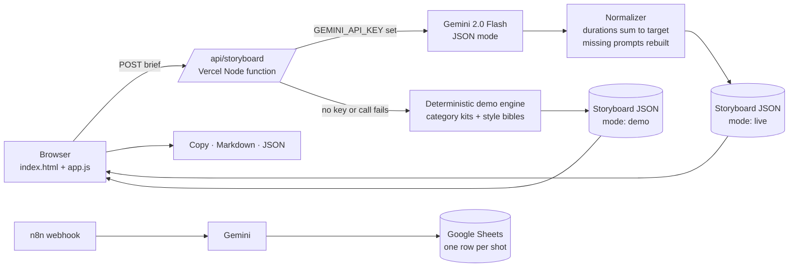

<div align="center">

<h1>AI Video Storyboard Studio</h1>

<p>Turn one idea into a timed AI video storyboard, with a shared style bible and per-shot prompts for Kling, Sora, Veo and keyframe tools.</p>

<p>
  <a href="https://ai-video-storyboard-studio.vercel.app"></a>
  <a href="#n8n-workflow"></a>
  <a href="LICENSE"></a>
  
  
</p>

<p>
  <a href="https://ai-video-storyboard-studio.vercel.app"><b>Live demo</b></a> ·
  <a href="#n8n-workflow"><b>n8n workflow</b></a> ·
  <a href="#how-it-works"><b>Architecture</b></a> ·
  <a href="#run-locally"><b>Run locally</b></a>
</p>

</div>

## Overview

AI video tools are costly to iterate on: vague prompts burn credits on clips that do not cut together, and characters, colours and lenses drift from shot to shot. This studio is the pre-production step before any credits are spent. It turns a brief into a beat structure, a shot list timed to exactly 15, 30 or 60 seconds, one consistency bible, and prompts written in each tool's own dialect.

The same workflow is behind the cinematic work at [@tarunaistudio](https://instagram.com/tarunaistudio).

## Highlights

- **Timed shot list.** Hook, Build, (Turn), Reveal, CTA, with durations in 0.5s steps that sum to the target exactly.
- **One style bible.** Subject, character, wardrobe, setting, palette, lens package, grade and negative prompt, shared by every shot.
- **Four prompt dialects.** Kling, Sora, Veo and a still keyframe prompt (Nanobanana / Krea), with generation-length hints per tool.
- **Voiceover script.** One timed line per beat at about 2.5 words per second, flagged when it runs tight.
- **Hand-off ready.** Copy one or all prompts, export Markdown for clients or JSON for pipelines, or push shots to a Google Sheet.
- **Works without a key.** A deterministic demo engine runs when Gemini is not configured. A badge shows which mode is active.

## How it works



1. The browser sends the brief to `POST /api/storyboard`: idea, brand, mood, duration (15 / 30 / 60s), aspect (9:16 / 16:9 / 1:1) and style.
2. The function validates input (idea up to 600 chars, brand 80, mood 40, enum-checked duration, aspect and style) and applies a per-IP rate guard (12 requests per minute by default).
3. **Live:** Gemini (`gemini-2.0-flash`, `responseMimeType: application/json`) writes the storyboard. The normalizer caps it at 16 shots, rescales durations, fixes beats and timecodes, and rebuilds any missing tool prompt from the bible.
4. **Demo:** the engine picks a category kit (luxury product, café/food, tech/SaaS, travel or generic), applies the style bible and writes all four dialects. The same brief always gives the same result.
5. The UI renders the timeline, shot cards, bible and voiceover, and handles copy and export in the browser.

## Business impact

Typical / estimated, based on agency-style AI video production. These are planning estimates, not measured results.

| Metric | Before | With the studio |
|---|---|---|
| Pre-production for a 30s spot | 2 to 4 hours of scripting and prompt writing | About 10 minutes to review and tweak |
| Wasted generations from inconsistent shots | Often 40 to 60% of credits | Estimated 20 to 30% fewer re-rolls |
| Client sign-off | Loose mood boards | A timed shot list and VO script approved before generation |

## Tech stack

| Layer | Tools |
|---|---|
| Frontend | Static `index.html`, `assets/style.css`, `assets/app.js` (vanilla ES modules, no build step) |
| API | Vercel Node serverless function `api/storyboard.js` (ESM, Node 18+ global `fetch`, no dependencies) |
| Model | Google Gemini REST API, optional |
| Automation | n8n, optional Google Sheets workflow |
| Type | Inter and JetBrains Mono via Google Fonts |

## Project structure

```
.
├── index.html
├── assets/
│   ├── style.css
│   ├── app.js
│   └── format.js              # formatting and export helpers, no DOM
├── api/
│   ├── storyboard.js          # POST endpoint, live with demo fallback
│   └── _lib/engine.js         # validation, demo engine, prompt dialects, normalizer (not a route)
├── n8n/storyboard-to-sheet.n8n.json
├── scripts/dev-server.mjs     # zero-dependency local server
└── package.json · vercel.json · LICENSE
```

## Run locally

```bash
node scripts/dev-server.mjs        # or: npx vercel dev
# open http://localhost:3000  (try ?preset=watch | cafe | saas | travel)
```

No key is needed. Without `GEMINI_API_KEY` the app runs in demo mode. On a plain static server with no functions, the browser runs the demo engine itself.

## Configuration

| Variable | Required | Purpose |
|---|---|---|
| `GEMINI_API_KEY` | No | Turns on live AI. If missing or the call fails, the API falls back to demo mode. Never sent to the client. |
| `GEMINI_MODEL` | No | Overrides the model. Default `gemini-2.0-flash`. |
| `GEMINI_TIMEOUT_MS` | No | Gemini request timeout. Default `20000`. |
| `RATE_LIMIT_PER_MIN` | No | Requests per IP per minute. Default `12`. |

## n8n workflow

[`n8n/storyboard-to-sheet.n8n.json`](n8n/storyboard-to-sheet.n8n.json) runs Webhook → Validate brief → Gemini: write storyboard → Split shots to rows → Append to Google Sheets → Respond. Each shot becomes a row (beat, timecode, camera, lens, lighting, action, SFX, VO, all four prompts, status *To generate*). The file contains no secrets.

1. Import the file into n8n.
2. Set `GEMINI_API_KEY` and `STORYBOARD_SHEET_ID` as n8n environment variables.
3. Create a `Shots` tab in the sheet. Headers are written on the first append.
4. Pick your Google Sheets credential on the Sheets node, then test:

```bash
curl -X POST https://<your-n8n>/webhook/storyboard-to-sheet \
  -H 'Content-Type: application/json' \
  -d '{"idea":"Café morning reel, latte art and croissants","brand":"Bean There","duration":15,"aspect":"9:16","mood":"cozy"}'
```

## Deploy

[](https://vercel.com/new/clone?repository-url=https://github.com/Saitarun29/ai-video-storyboard-studio&env=GEMINI_API_KEY)

Zero config. Vercel serves the static files and picks up `api/*.js` as functions.

## Roadmap

- Optional keyframe image generation (Nanobanana / Imagen) inside the cards
- More dialects: Seedance, Wan, Runway, Luma
- Drag to reorder and resize shots on the timeline, with live re-timing
- Shareable storyboard links and PDF client deck export

---

<div align="center">

Built by **Sai Tarun Ronanki** · AI Systems & Agentic Workflows Builder · Hyderabad

[saitarun.com](https://saitarun.com) · [LinkedIn](https://linkedin.com/in/ronanki-sai-tarun) · [X](https://x.com/SaiTarunRonanki)

**[Discuss your workflow →](https://wa.me/918008941430?text=Hello%20Sai%20Tarun%20Ronanki,%20I%20want%20to%20discuss%20about%20my%20workflow)**

MIT © 2026 Sai Tarun Ronanki

</div>
